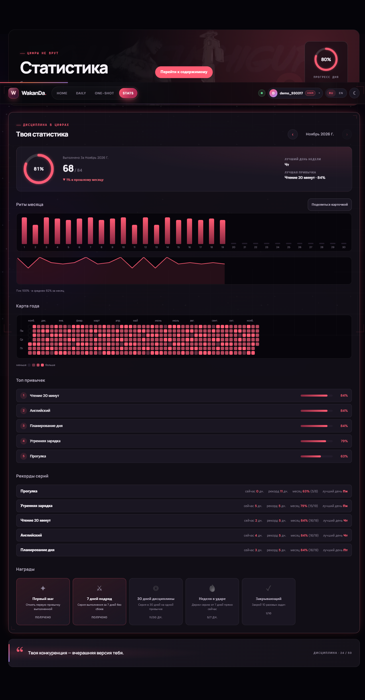
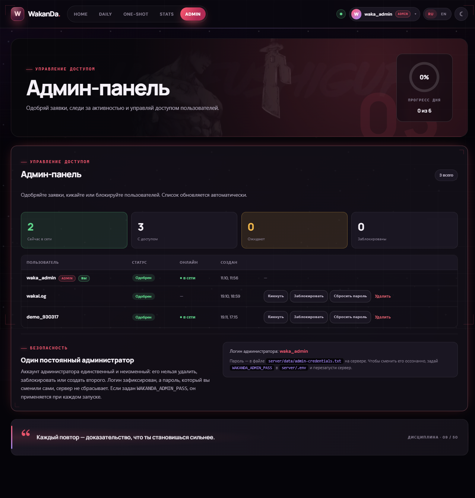

# WakanDa — дисциплина и привычки

Приложение для ежедневных привычек, разовых задач и напоминаний. Данные каждого
пользователя хранятся отдельно; сервер раздаёт интерфейс и API с одного домена.

## Стек

- **Frontend:** React 19, TypeScript, Vite, PWA (service worker).
- **Backend:** NestJS, SQLite, pino.
- **Уведомления:** Web Push и Telegram Bot API.
- **Деплой:** один Docker-образ, self-hosted, без платной инфраструктуры.

## Скриншоты

| Главная | Статистика и годовая карта |
| --- | --- |
|  |  |

| Карточка прогресса | Админ-панель |
| --- | --- |
|  |  |

Публичного демо нет: поднимите проект локально по инструкции ниже.

## Что умеет

- Привычки с паузами (болезнь/отпуск не сжигают серию), разовые задачи, заметки, темы.
- Статистика по месяцам: кольцо выполнения, тренд, «топ привычек», годовая карта.
- Карточка прогресса — готовый PNG для публикации.
- Регистрация, одобрение администратором, админ-панель, смена пароля и «выйти везде».
- Web Push до трёх раз в день и напоминания о разовых задачах.
- Telegram-бот: те же напоминания, сводка `/today`, задачи, отложить на 10 минут.
- Серверные снимки состояния (до 40) с откатом; оффлайн-правки не теряются.

## Быстрый старт

Нужен Node.js **22** (`.nvmrc`).

```bash
npm ci
npm ci --prefix server
npm run dev
```

- Интерфейс: http://localhost:5173
- API: http://localhost:3001/api
- Swagger: http://localhost:3001/api/docs

Проверка перед релизом: `npm run check`, `npm run test:server`, `npm run test:e2e`.
Подробности команд — в [docs/deployment.md](docs/deployment.md#разработка).

## Документация

- [Деплой, переменные, HTTPS, PWA и бэкапы](docs/deployment.md)
- [Telegram-бот и формат напоминаний](docs/telegram.md)
- [API и Swagger](docs/api.md)
- [Безопасность и хранение токена](docs/security.md)
- [Логи и наблюдаемость](docs/observability.md)
- [Архитектура и правила расширения](docs/architecture.md)

## Ограничения и roadmap

Сейчас осознанно не сделано:

- один администратор и восстановление пароля только через него;
- SQLite и один процесс — нет горизонтального масштабирования и HA;
- Chrome на iOS не ставит PWA (только Safari → «На экран „Домой“»).

В планах: мульти-админ, self-service recovery, экспорт/импорт через UI и
опциональный внешний планировщик для нескольких инстансов. Подробнее — в
[docs/architecture.md](docs/architecture.md#ограничения-и-roadmap).

## Лицензия

[MIT](LICENSE).
